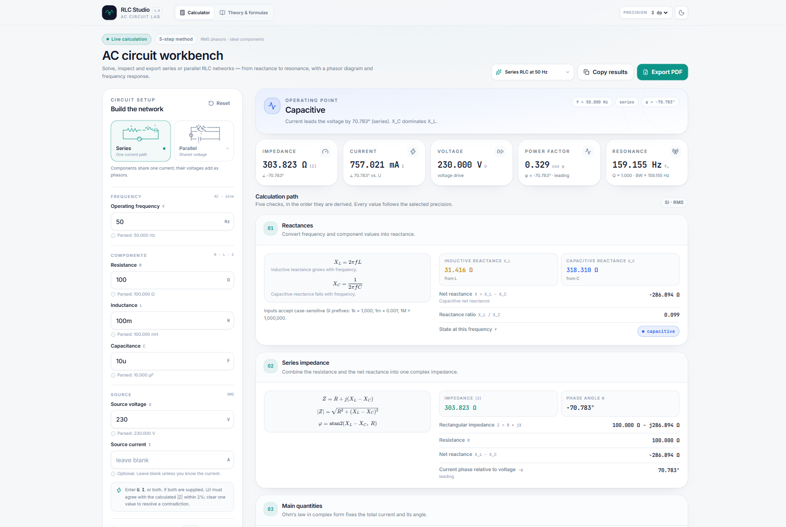
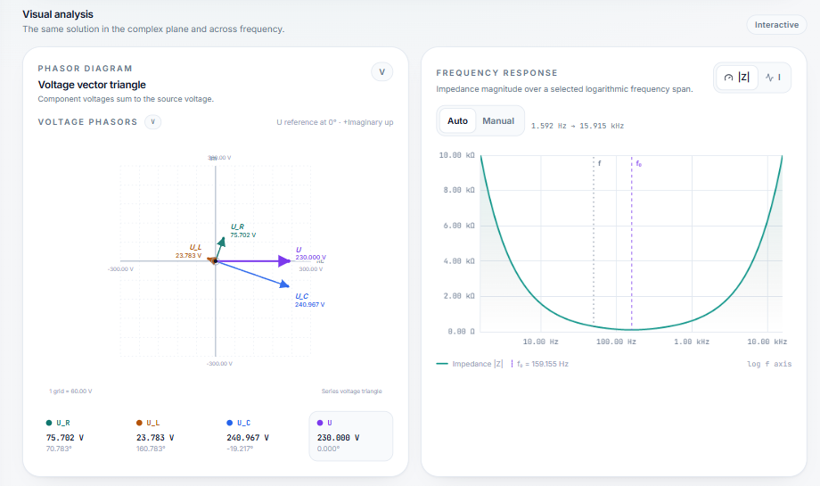
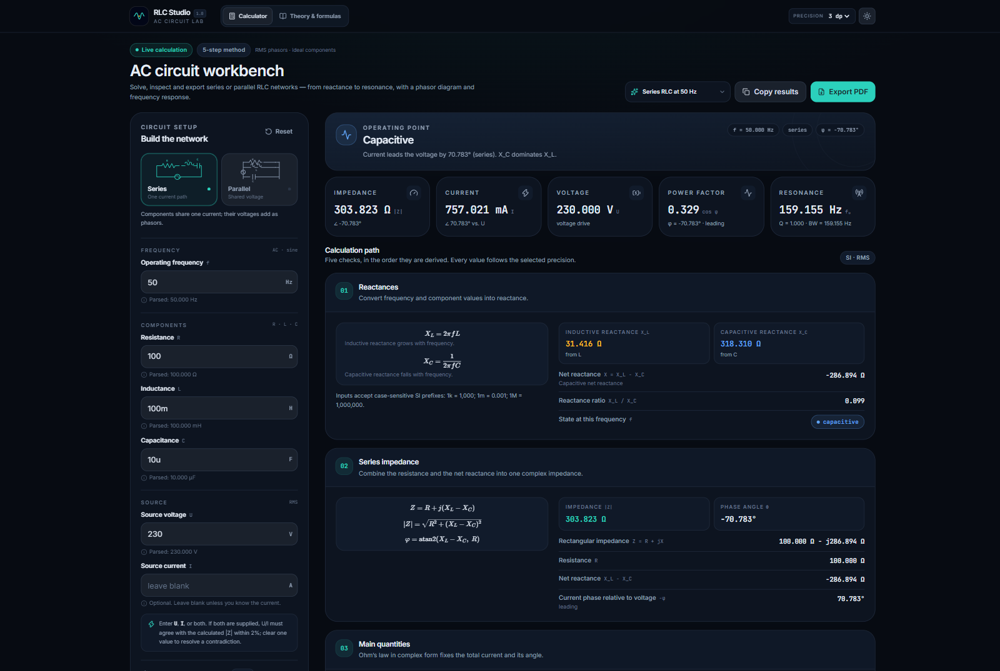

# RLC Studio

[](https://marcvandamme.github.io/rlc-studio/)

A browser-based workbench for series and parallel RLC circuits. RLC Studio turns component values into a complete AC solution, walks through the calculation in five steps, and presents the result as numbers, LaTeX formulas, a phasor diagram, and an interactive frequency-response chart.



## Why RLC Studio

Most circuit calculators return a single impedance or current. RLC Studio is built for learning and verification as much as for answers:

- **Five-step workflow** — reactances, branch values and impedance, main quantities, component voltages or currents, then power, phase, and resonance.
- **Series and parallel networks** — formulas, branch values, labels, and phasor diagrams adapt to the selected topology.
- **SI-aware inputs** — parse `4.7k`, `100mH`, `2.2uF`, `159.15Hz`, and other SI notation with case-sensitive prefixes.
- **Direct reactance entry** — optional `X_L`, `X_C`, and known `|Z|` fields accept an `L`, `C`, or `Z` suffix for work with datasheet or measured reactances.
- **Precision control** — choose 0–6 decimal places; result values update immediately throughout the interface, report, and PDF.
- **Validation with context** — negative components, zero-frequency AC, impossible parallel shorts, and contradictory `U`/`I` inputs are explained rather than silently ignored.
- **Visual analysis** — an interactive phasor plot and a logarithmic frequency sweep for impedance or line current.
- **Teaching layer** — dynamic LaTeX formulas and plain-language explanations for inductive, capacitive, resistive, and resonant operation.
- **Reports** — export a typeset PDF with charts or copy a formatted plain-text report to the clipboard.
- **Light and dark themes** — the interface and charts share the same theme-aware palette.



The theme switch applies to the whole workspace, including chart gridlines, phasor labels, and result cards.



## Quick start

Requires Node.js 20 or newer.

```bash
npm install
npm run dev
```

Open the local URL printed by Vite. The production build is fully static:

```bash
npm run build
npm run preview
```

## How it works

### 1. Reactances

For a frequency `f`, inductance `L`, and capacitance `C`:

```text
X_L = 2πfL
X_C = 1 / (2πfC)
```

Direct reactance overrides replace the computed values. When an override is present, the effective `L` or `C` is re-derived at the operating frequency so resonance calculations remain consistent.

### 2. Impedance

Series networks use rectangular impedance:

```text
Z = R + j(X_L − X_C)
```

Parallel networks combine branch admittances:

```text
Y = 1/R + 1/(jX_L) + j/X_C
Z = 1/Y
```

### 3. Source quantities

With a voltage source, `I = U / |Z|`. With a current source, `U = I × |Z|`. Supplying both is allowed only when `U/I` agrees with the calculated impedance within 2%; otherwise the input is rejected with a diagnostic.

### 4. Components

Series circuits resolve `U_R`, `U_L`, and `U_C` as phasors that sum to the source voltage. Parallel circuits resolve branch currents that sum to the line current.

### 5. Power and resonance

```text
S = UI
P = UI cos φ
Q = UI sin φ
f₀ = 1 / (2π√(LC))
```

The quality factor, bandwidth, characteristic impedance, frequency ratio, and damping ratio are reported for series and parallel networks. Power-factor correction uses the constant-power approximation to size a parallel capacitor.

## Input syntax

| Input | Examples |
| --- | --- |
| Frequency | `50`, `1k`, `60Hz` |
| Resistance | `100`, `4.7k` |
| Inductance | `100m`, `100mH`, `2.2u` |
| Capacitance | `10u`, `10uF`, `2.2µF` |
| Voltage / current | `230`, `12`, `500m` |
| Reactance overrides | `80L`, `120C` |
| Known impedance | `100Z` |

SI prefixes are case-sensitive: `M` is mega, `k` is kilo, `m` is milli, `u`/`µ`/`μ` is micro, `n` is nano, and `p` is pico.

## Engineering assumptions

- Sinusoidal steady state and RMS magnitudes.
- Ideal components unless a resistance is explicitly supplied.
- The source voltage is the phasor reference at `0°`.
- Reactive power is positive for inductive networks.
- Power-factor correction assumes the capacitor does not change the load's active power or terminal voltage.
- Chart axis ticks are rounded for readability; result values follow the selected precision.

## Project structure

```text
src/
  components/       Input controls, result panels, plots, and UI primitives
  config/           Defaults and example circuits
  domain/           Parsing, complex arithmetic, RLC engine, formatting, reporting
  hooks/            Theme and persisted-state hooks
  lib/              Clipboard, PDF generation, and plot scaling
  pages/            Theory and formula reference
```

The domain layer is framework-independent and covered by unit tests. UI components consume the typed `CircuitAnalysis` result rather than recalculating electrical values.

## Scripts

| Command | Purpose |
| --- | --- |
| `npm run dev` | Start the Vite development server |
| `npm run build` | Type-check and create a production build |
| `npm run preview` | Preview the production build locally |
| `npm test` | Run the Vitest suite once |
| `npm run test:watch` | Run tests in watch mode |
| `npm run typecheck` | Run TypeScript without emitting files |

## Deployment

The live demo is served from GitHub Pages: **https://marcvandamme.github.io/rlc-studio/**

The `Deploy to GitHub Pages` workflow builds the project and publishes `dist/` on every push to `main`. The Vite config uses a relative base, so the same build can also be hosted on Netlify, Vercel, Cloudflare Pages, or any static web server.

## Contributing

Bug reports, calculation checks, and focused pull requests are welcome. Please keep the domain layer deterministic and add tests for formula or validation changes.

## License

[MIT](LICENSE)
